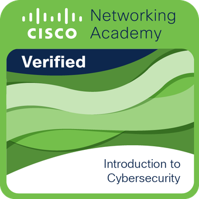
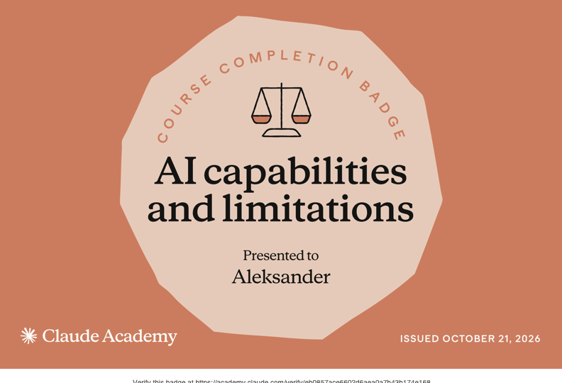
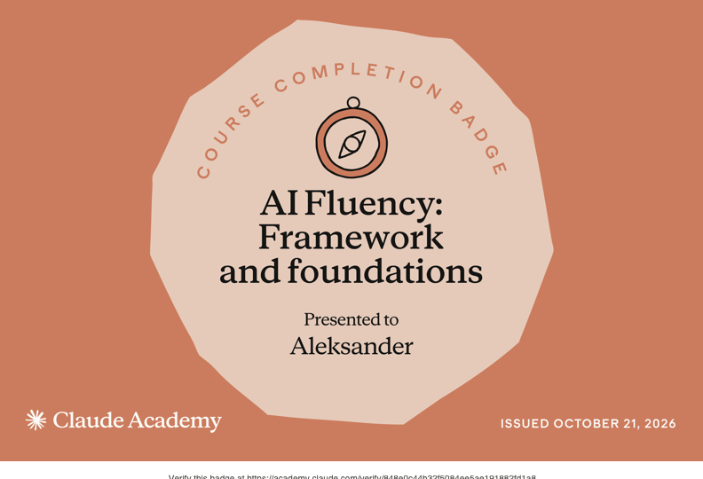

# Aleksander Dahl-Andersen

Cybersikkerhetsstudent, Oslo

## Profil

Tredjeårsstudent i cybersikkerhet ved Høyskolen Kristiania. Jeg har hatt fag som cyberforsvar, skysikkerhet og etisk hacking, og lærer nå IoT/OT-sikkerhet og Governance, Risk and Compliance (GRC). Jeg har praktisk erfaring med kvalitetssikring av AI-genererte svar hos Concentrix, og rundt 8 års erfaring med selvstendig ansvar og teamarbeid fra detaljhandelen. Nå ønsker jeg en rolle der jeg kan bruke den brede sikkerhetskompetansen min i praksis.

## Sertifiseringer

  
  
  

Cisco Introduction to Cybersecurity, januar 2025. Claude Academy: AI capabilities and limitations og AI Fluency: Framework and foundations, oktober 2026.

## Prosjekter

**[Sikring av AI-agent mot indirekte prompt injection](https://github.com/alekdahl/foundry-agent-injection-lab)**
Bygget en dokumentassistent i Microsoft Foundry Agent Service som leser prosjektdokumenter og sender e-post, og testet den mot fem varianter av indirekte prompt injection. Målte fire forsvarslag (Prompt Shields, allowlist i verktøyet, herdet systemprompt og overvåking av verktøykall) hver for seg og samlet over 200 kjøringer: uten forsvar lekket agenten konfidensielle data i 60 % av angrepene, med alle lag i 0 %, uten falske blokkeringer. Viste at et oppdelt angrep slapp forbi både Prompt Shields og systemprompten, og at bare den deterministiske kontrollen i verktøyet stoppet det. Trusselmodellen er koblet til OWASP Top 10 for LLM og MITRE ATLAS.

**[Nettverksintrusjonsdeteksjon](https://github.com/alekdahl/network-intrusion-detection)**
Bygget og evaluerte maskinlæringsmodeller som klassifiserer angrepstyper i nettverkstrafikk, basert på UNSW-NB15-datasettet. Håndterte sterk klasseubalanse med class weights og SMOTE, og analyserte bias/variance-avveininger. Vurderte også modellen fra et SOC-perspektiv, med deteksjonsrate og antall falske alarmer per døgn, og viste at duplikater i datasettet ga for optimistiske resultater.

**[AI-assistert triage av SOC-alarmer](https://github.com/alekdahl/soc-alert-triage)**
Bygget en pipeline som kjører Windows-logger fra ekte angrep og fra en ren maskin gjennom over 4 500 Sigma-regler med Hayabusa, og lar Claude (Haiku og Sonnet) vurdere alarmene med strukturerte svar og MITRE ATT&CK-kobling. Laget fasit for 157 alarmer og målte resultatene: Sonnet oppdaget 94 % av angrepene og avfeide 92 % av de falske alarmene, mot 88 % og 82 % for Haiku til en fjortendedel av prisen.

**Penetrasjonstestrapport**
Gjennomførte en full penetrasjonstest og dokumenterte 13 sårbarheter med CVSS-scoring og konkrete utbedringsforslag. Brukte Nmap, OWASP ZAP, SQLmap og Metasploit i test- og verifikasjonsfasen.

## Erfaring

**AI Data Analyst, Concentrix** (hybrid)
Juni 2025 – november 2025
Kvalitetssikret og evaluerte AI-genererte svar for å forbedre modellens nøyaktighet i et seks måneder langt prosjekt.

**Butikkmedarbeider, Kiwi** (Ensjø, Lilleby, Moholt)
November 2018 – nå
Rundt 8 års sammenhengende erfaring fra tre butikker, blant annet med selvstendig ansvar for butikkdriften på kveldstid. Kåret til årets ansatt 2025 for innsats og lederskap.

## Utdanning

**Bachelor i cybersikkerhet, Høyskolen Kristiania, Oslo**
August 2024 – forventet 2027
Relevante emner: informasjonssikkerhet, etisk hacking, skysikkerhet, cyberforsvar, AI and Cybersecurity Applications, IoT/OT-sikkerhet, Governance, Risk and Compliance.

**Studiespesialisering, Sonans**
August 2023 – juni 2024

**Bachelor i eiendomsmegling, Handelshøyskolen BI** (avsluttet etter første semester)
August 2022 – januar 2023

## Kompetanse

- Sikkerhet: penetrasjonstesting, sårbarhetsanalyse, OWASP Top 10, OWASP Top 10 for LLM, MITRE ATT&CK, MITRE ATLAS, ISO/IEC 27001, NIST CSF
- Verktøy: Kali Linux, Microsoft Azure, Microsoft Foundry, Nmap, SQLmap, OWASP ZAP, Metasploit, Kubernetes, Splunk
- Programmering: Python, SQL, JavaScript, Java, HTML/CSS
- Språk: norsk (morsmål), engelsk (flytende)
